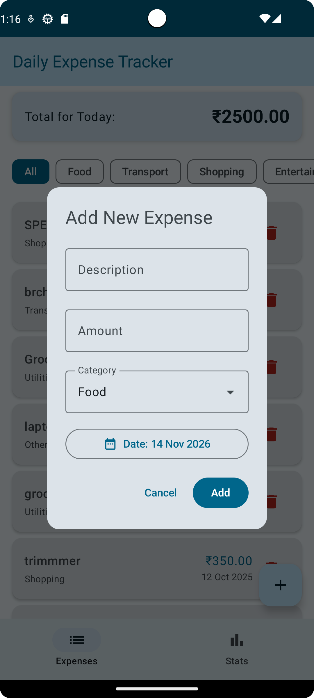
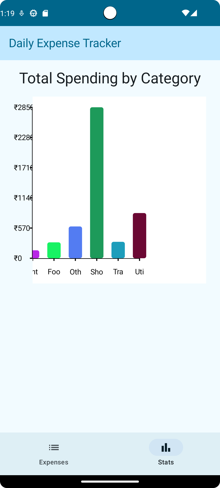

# 📊 Daily Expense Tracker with Visuals

An Android mobile application developed to help users manage their daily expenses, track spending habits, and analyze their financial activities through visual charts and graphs.

The application provides a simple and user-friendly interface where users can record expenses, organize them into different categories, view daily spending totals, and understand their expenditure patterns.

## ✨ Features

- **Add Expenses:** Add expenses with description, amount, category, and date.
- **Expense Management:** View and delete recorded expenses.
- **Category Filtering:** Filter expenses by Food, Transport, Shopping, Entertainment, and other categories.
- **Daily Spending Summary:** View the total expenses for the current day.
- **Visual Analytics:** Understand spending patterns through graphical representations.
- **Category-wise Statistics:** Analyze expenses across different categories using bar charts.
- **Simple UI:** Clean and user-friendly Android mobile interface.

## 📱 Application Screenshots

### 1. Expense Management

View all recorded expenses, check their categories, monitor amounts, and manage daily spending.


### 2. Add New Expense

Add a new expense by entering its description, amount, category, and date.



### 3. Expense Statistics

Visualize category-wise spending through a bar chart and understand where your money is being spent.



## 🛠️ Technologies & Platform

- **Platform:** Android
- **Build System:** Gradle
- **Build Configuration:** Kotlin DSL (`.gradle.kts`)

## 📂 Project Structure

```text
expense-tracker-with-visuals/
│
├── .idea/
│
├── app/
│   └── Android application source code
│
├── gradle/
│
├── screenshots/
│   ├── add-expense.png
│   ├── expense.png
│   ├── expenses.png
│   └── statics.png
│
├── .gitignore
├── build.gradle.kts
├── gradle.properties
├── gradlew
├── gradlew.bat
├── settings.gradle.kts
│
└── README.md
```

## 🎯 Project Objective

The main objective of this project is to make personal expense management easier and more organized. It helps users maintain a record of their daily expenses, identify spending patterns, and make better financial decisions through visual analysis.

## 📌 Project Information

- **Project Name:** Daily Expense Tracker with Visuals
- **Project Type:** Academic Project
- **Application:** Android Mobile Application
- **Currency:** Indian Rupee (₹)

---

⭐ If you find this project useful, consider giving this repository a star!
